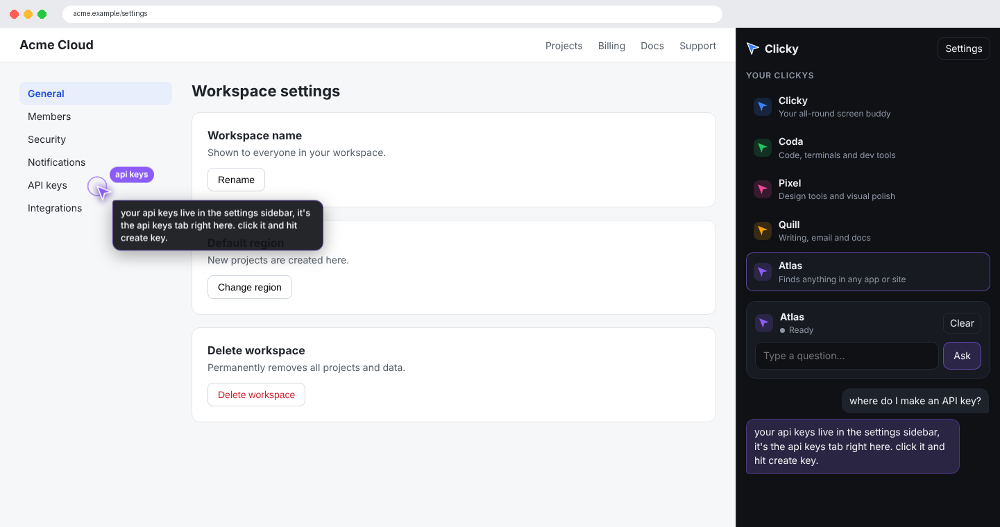

# lat.ai: Clicky for the web

A web version of [Clicky](https://github.com/farzaa/clicky): voice companions that see your screen, answer out loud, and fly a cursor to the thing you need.

It has three parts:

| Part | What it is |
|---|---|
| **Web home** (`web/`) | A home page with every Clicky as a card, a shared-screen preview, and a panel on the right to ask the selected one. The secondary cursor follows your mouse over the preview and flies to whatever Claude points at. |
| **Chrome extension** (`extension/`) | The same Clicky panel in Chrome's right-side panel. It sees the tab you're on (no screen sharing) and draws the secondary cursor **directly on the page**, snapping to the nearest button or link. With voice set up, hold <kbd>ctrl</kbd>+<kbd>option</kbd> on any page to talk. |
| **Worker** (`worker/`) | One Cloudflare Worker that serves the web home and proxies Claude, ElevenLabs and AssemblyAI, so no API key ever reaches a browser. |



The roster of Clickys lives in one file, `web/shared/clickys.js`. Each Clicky has a name, color, specialty and voice. The web home, the extension and the Worker all read it.

| Clicky | Specialty |
|---|---|
| Clicky | All-round screen buddy |
| Coda | Code, terminals and dev tools |
| Pixel | Design tools and visual polish |
| Quill | Writing, email and docs |
| Atlas | Finding anything in any app or site (points almost every time) |

## Typed or voice

Only the Anthropic key is required. Without the other two you type questions into the panel and replies appear as text, in the panel and in the cursor's bubble. Pointing works the same either way.

| Worker secret | Turns on |
|---|---|
| `ANTHROPIC_API_KEY` (required) | The Clickys' answers and pointing |
| `ASSEMBLYAI_API_KEY` (optional) | Talking: the hold-to-talk button, <kbd>Space</kbd>, and <kbd>ctrl</kbd>+<kbd>option</kbd> |
| `ELEVENLABS_API_KEY` (optional) | Spoken replies in each Clicky's voice |

Add a key with `npx wrangler secret put <NAME>` whenever you're ready. The site and the extension pick it up on their next load; nothing needs redeploying.

## How the cursor works

1. When you send a question, Clicky takes a screenshot (your shared screen, or the active tab) and shrinks it to 1280px on its longest side.
2. Claude gets the screenshot and its pixel size. It ends its reply with a tag like `[POINT:960,100:settings gear]`, or `[POINT:none]`.
3. `web/shared/pointing.js` strips the tag, so it is never spoken, and turns it into fractions of the screenshot.
4. Those fractions are mapped onto the preview (web) or the page (extension). `web/shared/cursor.js` then flies the cursor there along a curved path and shows the label.

## Setup

You need Node.js 20+, a free Cloudflare account, and an [Anthropic](https://console.anthropic.com) API key. Keys from [AssemblyAI](https://www.assemblyai.com) and [ElevenLabs](https://elevenlabs.io) are optional and add voice.

### 1. Deploy the Worker (this also puts the web home live)

```bash
npm run setup                  # installs the Worker's dependencies
cd worker
npx wrangler login
npx wrangler secret put ANTHROPIC_API_KEY
# optional, for voice:
# npx wrangler secret put ASSEMBLYAI_API_KEY
# npx wrangler secret put ELEVENLABS_API_KEY
npx wrangler deploy
```

`deploy` prints your site's address, such as `https://clicky-web.yourname.workers.dev`. Open it, pick a Clicky, click **Share screen**, then type a question in the panel on the right.

**Optional: lock it down.** Anyone who has the address can use your API credits. To require a password, run:

```bash
npx wrangler secret put ACCESS_TOKEN
```

Then enter the same value under **Settings** on the site and in the extension.

### 2. Install the Chrome extension

```bash
npm run build:extension        # copies web/shared into extension/shared
```

1. Open `chrome://extensions`, turn on **Developer mode**, click **Load unpacked** and choose the `extension` folder.
2. Click the Clicky icon in the toolbar (or press <kbd>Alt</kbd>+<kbd>Shift</kbd>+<kbd>K</kbd>). The panel opens on the right.
3. In the panel's **Settings**, paste your site address. Copy the `chrome-extension://…` origin shown there.
4. Put that origin into `ALLOWED_ORIGINS` in `worker/wrangler.toml`, then run `npx wrangler deploy` again. The Worker refuses browser requests from any other origin.
5. With voice set up, the first time you talk Chrome opens a tab asking for the microphone. Side panels can't show that prompt themselves. Allow it, close the tab, and talk again.

Re-run `npm run build:extension` and click reload in `chrome://extensions` whenever you change anything in `web/shared`.

### Local development

```bash
cd worker
printf 'ANTHROPIC_API_KEY=...\n' > .dev.vars   # gitignored; add the voice keys here too if you have them
npm run dev                    # http://localhost:8787
```

## Customizing

- **Add or change a Clicky:** edit `web/shared/clickys.js`. Set `voiceId` to any ElevenLabs voice ID, or `null` to use `ELEVENLABS_VOICE_ID`. Then deploy and rebuild the extension.
- **Model:** `CLAUDE_MODEL` in `worker/wrangler.toml` (default `claude-opus-5-5`). Replies use low effort so they come back quickly; change `effort` in `worker/src/index.ts` for deeper answers.
- **Voice and pointing rules:** `worker/src/prompt.ts`.

## Notes

- **Refusals:** the Worker opts into Claude's server-side refusal fallback (`fallbacks: "default"`). If Claude's safety classifiers decline a request, it is retried on Anthropic's recommended fallback model instead of failing.
- **Memory:** each Clicky remembers its own conversation (the last 10 turns) until you reload or press **Clear**. Only the newest turn carries a screenshot.
- **Web home limits:** browsers can't draw over other apps, so on the web home the cursor points on the preview of your shared screen. The extension points on the real page.
- **Pages the extension can't use:** Chrome blocks extensions on `chrome://` pages and the Web Store. The panel says so when you're on one.
- **Errors:** upstream key problems come back as HTTP 502 with the service named (for example, "Claude: 401 invalid x-api-key"). Run `npm --prefix worker run tail` to watch the Worker's logs live.

## Project layout

```
web/                 static site served by the Worker
  index.html, app.js, styles.css
  shared/            used by the web home, the extension, and (clickys.js) the Worker
    clickys.js       the roster
    conversation.js  push-to-talk → screenshot → Claude → speech → point
    voice.js         AssemblyAI streaming + pcm-worklet.js (16kHz PCM16)
    api.js           Worker client (streamed chat, TTS, transcription token)
    pointing.js      [POINT] tag parsing
    cursor.js        the secondary cursor
    panel.js/.css    the right-side Clicky panel
    keyboard.js      ctrl+option / Space push-to-talk
    screenshot.js    1280px JPEG encoding
extension/           Chrome MV3 extension (side panel + content script)
worker/              Cloudflare Worker (TypeScript, Anthropic SDK)
scripts/             build-extension.mjs
```
