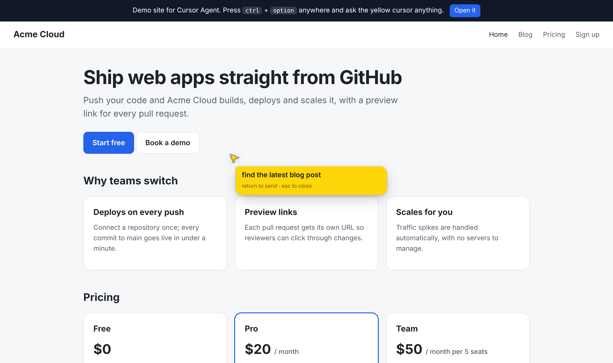
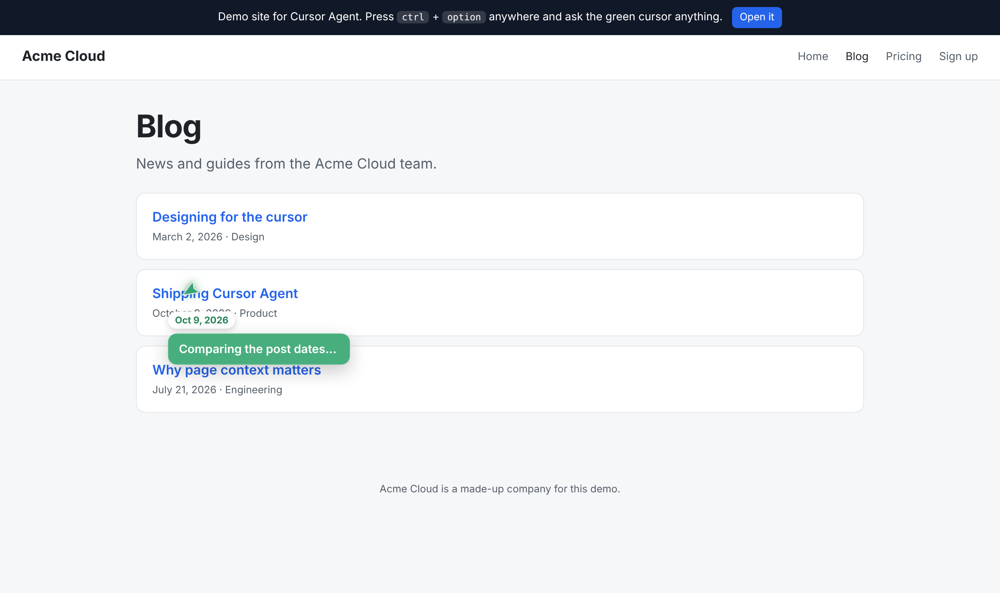
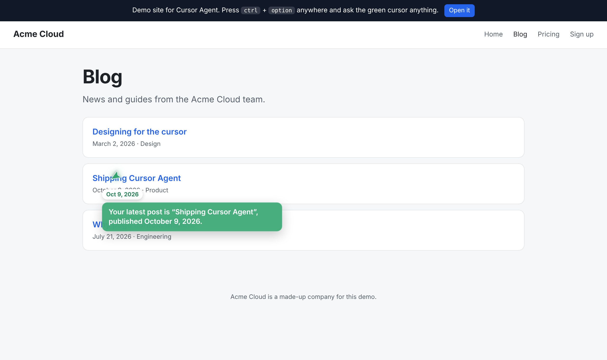

# lat.ai: Cursor Agent

A second cursor, a small yellow arrowhead facing the same way as your pointer (like [Clicky](https://github.com/farzaa/clicky)'s companion), that trails your own on any web page, with an AI agent inside. Nothing else shows until you call it: press **ctrl + option** (ctrl + alt on Windows/Linux) and a speech bubble opens from it. Type what you want and press return. The arrowhead glides around the page doing it, narrating in the bubble, answers there, then the bubble fades away. Press **esc** to stop or close; click an answer to reply.

Every request also captures **what's on screen** (with the agent hidden), tags each clickable element with its number, and sends that picture to Claude with the page text. So it sees layout, images and charts as well as the structure, and can point at any spot in the picture.

It works out where you are before it acts: the site, what kind of page it is, breadcrumbs, open dialogs, what's on screen, prices, which part of the page each control is in, and what your own pointer is resting on. So "what is this?" or "how much is that?" just work. It also picks the kind of help itself:

| It can | For example |
|---|---|
| **Do things** | "find the latest blog post": it clicks, types, chooses options, navigates across pages and calls the site's own actions until it's done. |
| **Explain** | "what am I looking at?": the arrowhead walks you through the page, pointing at each part. |
| **Troubleshoot** | "why won't this submit?": it reads on-screen errors, invalid fields, broken images and script errors, and points at the fix. |
| **Pitch** | "why should my team pick this?": it's the product's honest guide, using context the site owner provides, and ends on the next step. |
| **Guide you** | "help me create an account": a step plan with progress on the cursor ("2/5 · Add your work email"). It points at each step and checks in by itself every time you click, across pages. |







## Two ways to use it

- **Embed it in a website.** Add one script tag. Site owners can give the agent product context (for Pitch and Explain) and **site actions**: functions with typed parameters the agent can call.
- **Chrome extension.** Injects the same SDK into every page you visit, so the cursor works everywhere.

```html
<script src="https://YOUR-WORKER/cursor-agent.js"></script>
<script>
  CursorAgent.init({
    endpoint: "https://YOUR-WORKER",
    siteContext: "Acme Cloud hosts web apps. Plans: Free, Pro $20/mo, Team $50/mo per 5 seats. 14-day trial.",
    actions: [{
      name: "book_demo",
      description: "Request a sales demo for a team.",
      parameters: {
        type: "object",
        properties: { name: { type: "string" }, email: { type: "string" }, team_size: { type: "integer" } },
        required: ["name", "email", "team_size"],
      },
      run: async ({ name, email, team_size }) => myCrm.createLead({ name, email, team_size }),
    }],
  });
</script>
```

Other options: `color` (the arrowhead and bubble; the text color adapts), `placeholder`, `screenCapture` (`"tab"` asks the visitor once per page to share the tab so the agent gets screenshots; default `"off"`), `showCursor` (`"always"` or `"active"`), `hotkey`, `maxSteps`. From code you can call `CursorAgent.open()`, `CursorAgent.ask("…")` (optionally forcing a mode: `"do"`, `"explain"`, `"troubleshoot"`, `"pitch"` or `"guide"`), `CursorAgent.registerAction({...})` and `CursorAgent.setSiteContext("…")`.

## How it works

1. The SDK writes a text snapshot of the page: where the user is (site, page kind, breadcrumbs, dialogs, prices, what's under their pointer), then the visible links, buttons, fields and headings numbered and tagged by region, a text excerpt, error messages and any site context.
2. It also takes a screenshot of the visible page, hiding itself for that frame, and draws each element's number on it. The extension captures the tab silently; an embedding site uses `screenCapture: "tab"`, which asks once to share the tab. If there's no screenshot, the agent works from the text alone.
3. Your request, the snapshot and the screenshot go to the Worker. The Worker calls Claude with the page tools (`point`, `point_at_spot`, `click`, `type`, `select_option`, `scroll`, `navigate`, `read_page`, `set_plan`, `complete_step`) plus the site's own actions. `read_page` returns a fresh snapshot and screenshot.
4. The SDK runs each tool on the page, gliding the arrowhead to each element first, and sends the results back. This repeats until Claude answers in the speech bubble.
5. If an action loads a new page, the SDK saves the task as the page unloads and carries on when the next page opens.

**Fast judgments with TypeSafe (optional).** If the Worker has a `TYPESAFE_API_KEY`, two quick decisions use [TypeSafe](https://typesafe.ai)'s System One models instead of relying on Claude alone:
- **"Go ahead?" before anything consequential.** Before a click, an Enter-submit or a site action (plain navigation links are skipped), code asks whether it would commit something hard to undo, such as a purchase, payment, deletion, message or personal details, and whether the user explicitly asked for exactly that. If it's likely consequential and not explicitly requested, the bubble asks the user to approve it before acting. This is enforced in code, not just requested in the prompt.
- **Cheaper guide check-ins.** After each click during Guide me, TypeSafe judges which plan steps are now done and whether the user has drifted. Finished steps tick off right away, and Claude is only called when a step finished or the user went off course; otherwise nothing happens.

Without the key, both fall back to Claude-only behavior. The thresholds are in `web/cursor-agent.js` (`CONSEQUENTIAL_ACTION_THRESHOLD`, `STEP_COMPLETE_THRESHOLD`, …) and are starting points to tune on real use.

**Safety rails:**
- Password, one-time-code and payment-card fields are never shown to the agent or typed into.
- The agent is told to ask before anything irreversible: payments, deleting things, sending messages, or submitting personal details.
- Page text is treated as data, never as instructions.
- Navigation is limited to http and https addresses.

## Setup without a terminal (all in the browser)

1. In the [Cloudflare dashboard](https://dash.cloudflare.com), go to **Workers & Pages → Create → Import a repository**. Connect GitHub and pick this repo.
2. Set **Project name** to `cursor-agent` (it must match `name` in `worker/wrangler.toml`), **Root directory** to `worker`, **Build command** to `npm install`, and **Deploy command** to `npx wrangler deploy`. Choose the branch that has this code.
3. After the first deploy, open the Worker, go to **Settings → Variables and Secrets → Add**, choose type **Secret**, and name it `ANTHROPIC_API_KEY`. Paste your key as the value and click **Deploy**.
4. Open the `*.workers.dev` address shown on the Worker's page.

From then on, every commit to that branch redeploys automatically. That includes edits made on github.com, such as adding an origin to `ALLOWED_ORIGINS`.

**Extension without a terminal:** on GitHub, click **Code → Download ZIP** and unzip it. Then load the `extension` folder as described below. It's ready to use as is.


You need Node.js 20+, a free Cloudflare account, and an [Anthropic](https://console.anthropic.com) API key.

```bash
npm run setup                 # installs the Worker's dependencies
cd worker
npx wrangler login
npx wrangler secret put ANTHROPIC_API_KEY
# optional: fast safety checks and cheaper guide check-ins
# npx wrangler secret put TYPESAFE_API_KEY
npx wrangler deploy
```

`deploy` prints an address such as `https://cursor-agent.yourname.workers.dev`. Open it to try the demo site (Acme Cloud, a made-up company with a blog, pricing and a sign-up form). Press **ctrl + option** and try:
- "find the latest blog post"
- "why should my team pick this?"
- On the sign-up page, click **Create account** first, then ask "why won't this submit?"
- "help me create an account"

To embed it on another site, add that site's origin to `ALLOWED_ORIGINS` in `worker/wrangler.toml` and redeploy.

**Optional: require a password.** Run `npx wrangler secret put ACCESS_TOKEN` and pass the same value as `accessToken` (or enter it in the extension's options). Without it, anyone on an allowed origin can use your API credits.

### Chrome extension

If you change `web/cursor-agent.js`, run `npm run build:extension` to copy it into `extension/`. The copy is committed, so a fresh download already works.

1. Open `chrome://extensions`, turn on **Developer mode**, click **Load unpacked** and choose the `extension` folder.
2. The options page opens. Paste your Worker address and copy the `chrome-extension://…` origin it shows.
3. Add that origin to `ALLOWED_ORIGINS` in `worker/wrangler.toml` and run `npx wrangler deploy` again.
4. On any page, press **ctrl + option**, click the toolbar icon, or press **Alt + Shift + K**.

Chrome doesn't let extensions run on its own pages (`chrome://`) or the Web Store. Re-run `npm run build:extension` and reload the extension whenever the SDK changes.

### Local development

```bash
cd worker
printf 'ANTHROPIC_API_KEY=...\n' > .dev.vars   # gitignored
npm run dev                                     # http://localhost:8787
```

## Settings

In `worker/wrangler.toml`:
- `CLAUDE_MODEL` (default `claude-opus-5-5`)
- `AGENT_EFFORT` (default `low` for speed; raise to `medium` or `high` for harder multi-step tasks)
- `ALLOWED_ORIGINS`

The Worker opts into Claude's server-side refusal fallback: if a request is declined by a safety classifier, it's retried on Anthropic's recommended fallback model. The system prompt and tools are prompt-cached, so the later steps of a task are cheaper.

Run `npm --prefix worker run tail` to watch the Worker's logs live.

## Project layout

```
web/
  cursor-agent.js   the SDK: arrowhead cursor, speech bubble, page snapshot, screenshots, tools, agent loop (no dependencies)
  index.html, blog.html, blog/, signup.html, demo.css, demo.js   the Acme Cloud demo site
worker/             Cloudflare Worker: serves web/ and runs agent steps (POST /api/agent)
  src/index.ts      route, access control, site-action validation, Claude call
  src/agent.ts      system prompt (modes) and built-in page tools
  src/judgments.ts  optional TypeSafe judgments: action risk, guide progress (POST /api/judge)
extension/          Chrome MV3 extension: injects the SDK everywhere, proxies requests, options page
scripts/            build-extension.mjs
```

The earlier version of this project (a web home with five voice Clickys and a side-panel extension) is in the git history if you want to bring parts of it back.
