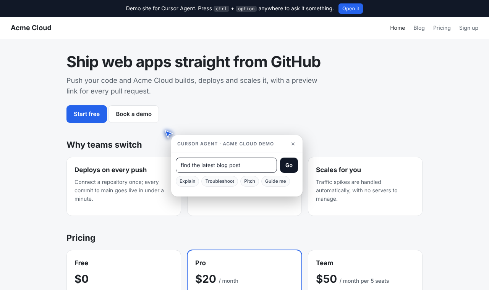
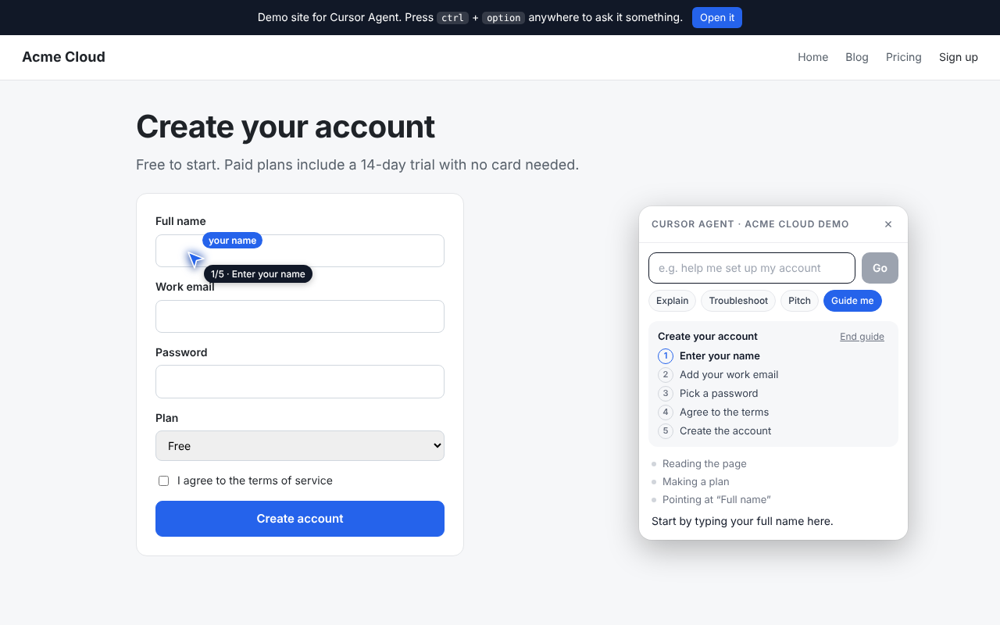
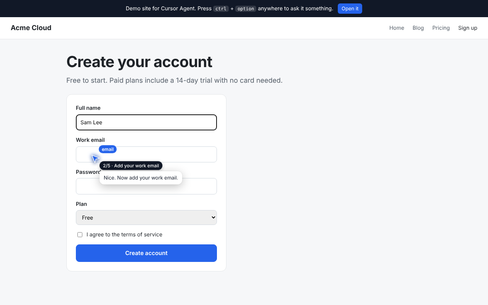

# lat.ai: Cursor Agent

A second cursor, like [Clicky](https://github.com/farzaa/clicky)'s, that trails your own on any web page and has an AI agent inside. Press **ctrl + option** (ctrl + alt on Windows/Linux) and a small card pops out of it. Ask anything. The agent reads the page you're on and can:

| Mode | What it does |
|---|---|
| **Do** (default) | Makes things happen: clicks, types, picks options, scrolls, navigates across pages, and calls the site's own actions until the job is done. |
| **Explain** | Walks you through the page, flying the cursor to each part as it explains it. |
| **Troubleshoot** | Reads on-screen error messages, invalid fields, broken images and script errors, says what's wrong in plain words, and points at the fix. |
| **Pitch** | Acts as the product's guide for a visitor, using context the site owner provides. It answers questions honestly, points at pricing and proof, and ends on the next step, like sign-up. |
| **Guide me** | Keeps you on track: makes a short step plan, shows progress on the cursor ("2/5 · Add your work email"), points at what to do next, and checks in by itself every time you click, even with the card closed. It follows you across pages. |







## Two ways to use it

- **Embed it in a website.** Add one script tag. Site owners can give the agent product context (for Pitch and Explain) and **site actions**: functions with typed parameters the agent can call.
- **Chrome extension.** Injects the same SDK into every page you visit, so the cursor works everywhere.

```html
<script src="https://YOUR-WORKER/cursor-agent.js"></script>
<script>
  CursorAgent.init({
    endpoint: "https://YOUR-WORKER",
    siteContext: "Acme Cloud hosts web apps. Plans: Free, Pro $20/mo, Team $50/mo per 5 seats. 14-day trial.",
    actions: [{
      name: "book_demo",
      description: "Request a sales demo for a team.",
      parameters: {
        type: "object",
        properties: { name: { type: "string" }, email: { type: "string" }, team_size: { type: "integer" } },
        required: ["name", "email", "team_size"],
      },
      run: async ({ name, email, team_size }) => myCrm.createLead({ name, email, team_size }),
    }],
  });
</script>
```

Other options: `color`, `label`, `showCursor` (`"always"` or `"active"`), `hotkey`, `maxSteps`. From code you can call `CursorAgent.open()`, `CursorAgent.ask("…", "guide")`, `CursorAgent.registerAction({...})` and `CursorAgent.setSiteContext("…")`.

## How it works

1. The SDK numbers the page's visible links, buttons, fields and headings, and adds the URL, a text excerpt, error messages and any site context. This is a text snapshot; no screenshots are taken.
2. Your request and the snapshot go to the Worker. The Worker calls Claude with the page tools (`point`, `click`, `type`, `select_option`, `scroll`, `navigate`, `read_page`, `set_plan`, `complete_step`) plus the site's own actions.
3. The SDK runs each tool on the page, animating the cursor to each element first, and sends the results back. This repeats until Claude answers in the card.
4. If an action loads a new page, the SDK saves the task as the page unloads and carries on when the next page opens.

**Safety rails:**
- Password, one-time-code and payment-card fields are never shown to the agent or typed into.
- The agent is told to ask before anything irreversible: payments, deleting things, sending messages, or submitting personal details.
- Page text is treated as data, never as instructions.
- Navigation is limited to http and https addresses.

## Setup

You need Node.js 20+, a free Cloudflare account, and an [Anthropic](https://console.anthropic.com) API key.

```bash
npm run setup                 # installs the Worker's dependencies
cd worker
npx wrangler login
npx wrangler secret put ANTHROPIC_API_KEY
npx wrangler deploy
```

`deploy` prints an address such as `https://cursor-agent.yourname.workers.dev`. Open it to try the demo site (Acme Cloud, a made-up company with a blog, pricing and a sign-up form). Press **ctrl + option** and try:
- "find the latest blog post"
- **Pitch**: "why should my team pick this?"
- On the sign-up page, click **Create account** first, then **Troubleshoot**: "why won't this submit?"
- **Guide me**: "help me create an account"

To embed it on another site, add that site's origin to `ALLOWED_ORIGINS` in `worker/wrangler.toml` and redeploy.

**Optional: require a password.** Run `npx wrangler secret put ACCESS_TOKEN` and pass the same value as `accessToken` (or enter it in the extension's options). Without it, anyone on an allowed origin can use your API credits.

### Chrome extension

```bash
npm run build:extension       # copies web/cursor-agent.js into extension/
```

1. Open `chrome://extensions`, turn on **Developer mode**, click **Load unpacked** and choose the `extension` folder.
2. The options page opens. Paste your Worker address and copy the `chrome-extension://…` origin it shows.
3. Add that origin to `ALLOWED_ORIGINS` in `worker/wrangler.toml` and run `npx wrangler deploy` again.
4. On any page, press **ctrl + option**, click the toolbar icon, or press **Alt + Shift + K**.

Chrome doesn't let extensions run on its own pages (`chrome://`) or the Web Store. Re-run `npm run build:extension` and reload the extension whenever the SDK changes.

### Local development

```bash
cd worker
printf 'ANTHROPIC_API_KEY=...\n' > .dev.vars   # gitignored
npm run dev                                     # http://localhost:8787
```

## Settings

In `worker/wrangler.toml`:
- `CLAUDE_MODEL` (default `claude-opus-5-5`)
- `AGENT_EFFORT` (default `low` for speed; raise to `medium` or `high` for harder multi-step tasks)
- `ALLOWED_ORIGINS`

The Worker opts into Claude's server-side refusal fallback: if a request is declined by a safety classifier, it's retried on Anthropic's recommended fallback model. The system prompt and tools are prompt-cached, so the later steps of a task are cheaper.

Run `npm --prefix worker run tail` to watch the Worker's logs live.

## Project layout

```
web/
  cursor-agent.js   the SDK: cursor, card, page snapshot, tools, agent loop (no dependencies)
  index.html, blog.html, blog/, signup.html, demo.css, demo.js   the Acme Cloud demo site
worker/             Cloudflare Worker: serves web/ and runs agent steps (POST /api/agent)
  src/index.ts      route, access control, site-action validation, Claude call
  src/agent.ts      system prompt (modes) and built-in page tools
extension/          Chrome MV3 extension: injects the SDK everywhere, proxies requests, options page
scripts/            build-extension.mjs
```

The earlier version of this project (a web home with five voice Clickys and a side-panel extension) is in the git history if you want to bring parts of it back.
